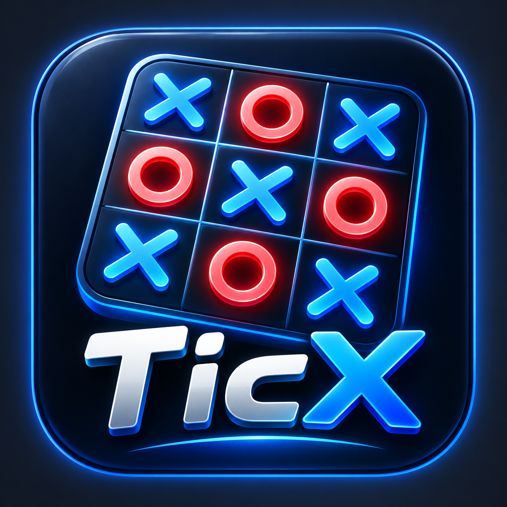

TicX
Modern JavaFX Tic-Tac-Toe Game

  

  # TicX

  **Tic-Tac-Toe Reimagined**

  A JavaFX Tic-Tac-Toe game featuring AI opponents, multiple difficulty levels, player profiles, and score tracking.

---
## Download using link [https://github.com/Ayush-yadav1203/TicX/releases/latest/download/TicX-1.0.exe?utm_source=chatgpt.com](https://github.com/Ayush-yadav1203/TicX/archive/refs/heads/main.zip?utm_source=chatgpt.com)

## Features

- Player vs Player
- Player vs Computer
- Easy, Medium, and Hard AI
- Player profiles and saved statistics
- Game history and score tracking
- JavaFX desktop interface
- Windows installer

✨ Features
🎮 Game Modes
🤖 AI Difficulties
🧠 Minimax Algorithm
👤 Player Profile
📊 Statistics
📜 Game History
🌙 Dark/Light Mode

🛠 Tech Stack
Java
JavaFX
Maven
Git/GitHub

▶️ How to Run directly through github
Make sure Java 24 and Maven are installed.
open terminal -- mvn javafx:run

🎯 Future Improvements
- 🔊 Sound effects
- ⚙️ Settings screen
- 📈 Advanced player statistics
- 🏅 Achievement system
- 🌐 Online multiplayer
- 🎨 More themes
- 🪪 Authentications

  
👨‍💻 Author
Ayush Yadav
